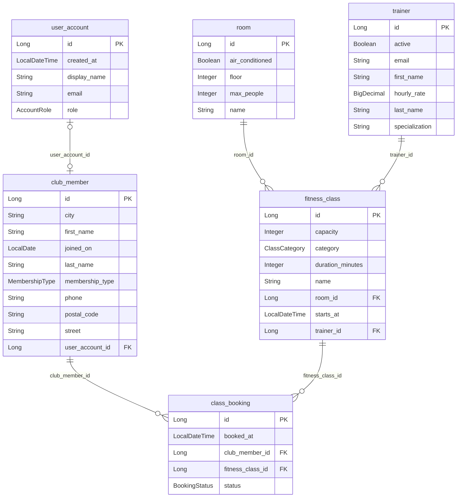

# Schemat bazy danych

Plik generują reguły projektu (panel Maven → Lifecycle → verify). Nie edytujcie go ręcznie.

Tabele: 6 · kolumny: 40 · relacje: 4 × @ManyToOne, 1 × @OneToMany, 1 × @OneToOne, 0 × @ManyToMany

| Tabela | Encja | Kolumny | Klucze obce |
|---|---|---|---|
| class_booking | ClassBooking | 5 | club_member_id, fitness_class_id |
| club_member | ClubMember | 10 | user_account_id |
| fitness_class | FitnessClass | 8 | room_id, trainer_id |
| room | Room | 5 | — |
| trainer | Trainer | 7 | — |
| user_account | UserAccount | 5 | — |

